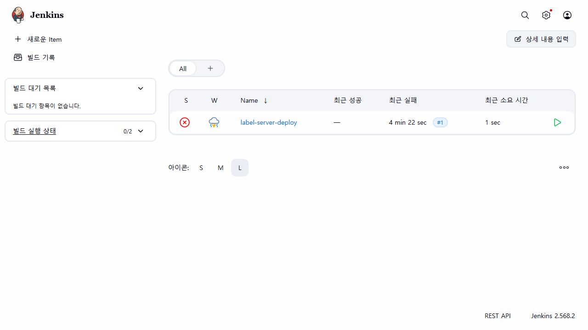
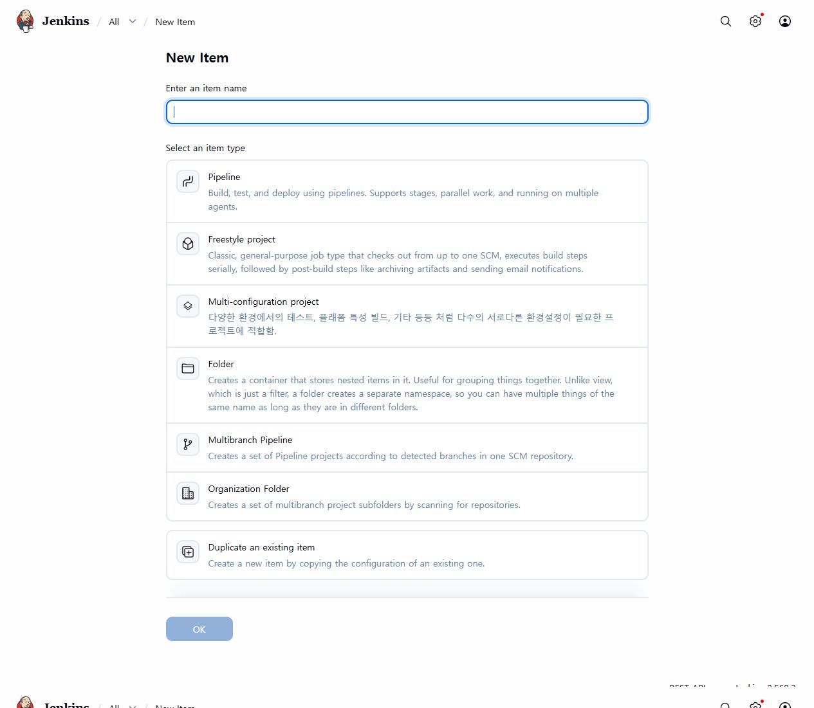
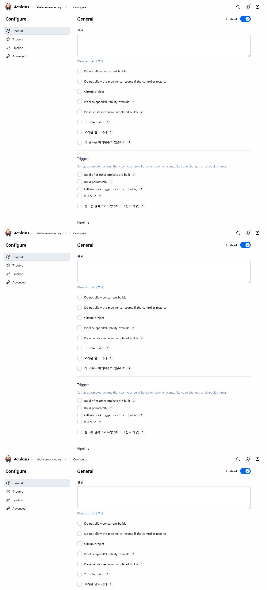

# Docker Jenkins 자동 배포 매뉴얼

이 매뉴얼은 `label` 소스를 GitHub에 올리면 Jenkins가 자동으로 테스트하고,
통과하면 `labelprint.pji.co.kr` 서버에 배포하도록 설정하는 방법입니다.

## 현재 설치 결과

- Jenkins: Docker 컨테이너 `papa-label-jenkins`
- Jenkins 버전: 2.568.2
- Docker Engine: 29.7.2
- Jenkins 내부 Node.js: 20.20.2
- Jenkins 내부 npm: 10.8.2
- Jenkins 화면: 외부 공개하지 않고 SSH 터널로 접속
- Jenkins Pipeline 이름: `label-server-deploy`
- 배포 대상: `54.180.136.194`
- 서비스: `label-server.service`

현재 서버는 4GB급 Lightsail이므로 Jenkins 컨테이너 메모리는 768MB로 제한되어 있습니다.
Jenkins와 라벨 서버를 장기적으로 많이 사용한다면 Jenkins를 별도 서버로 옮기는 것이 좋습니다.

## 1. Jenkins 화면 열기

PowerShell에서 실행합니다.

```powershell
$key='D:\바탕TEMP\180308바탕화면폴더\클라우드신청서\메가존\papa_lightsails\LightsailDefaultKey-ap-northeast-2.pem'
$ssh='C:\Program Files\Git\usr\bin\ssh.exe'
& $ssh -N -L 8080:127.0.0.1:8080 -F /dev/null -i $key -o IdentitiesOnly=yes ubuntu@54.180.136.194
```

위 창은 닫지 말고 그대로 둡니다. 브라우저에서 다음 주소를 엽니다.

```text
http://127.0.0.1:8080
```



## 2. 첫 로그인

처음 설치했을 때 초기 비밀번호는 서버에서 확인합니다.

```powershell
& $ssh -F /dev/null -i $key -o IdentitiesOnly=yes ubuntu@54.180.136.194 'sudo docker exec papa-label-jenkins cat /var/jenkins_home/secrets/initialAdminPassword'
```

처음 화면에서:

1. 초기 비밀번호 입력
2. `Install suggested plugins` 클릭
3. 관리자 계정 설정
4. Jenkins URL은 현재 테스트 단계에서는 `http://127.0.0.1:8080/` 사용

실제 외부 공개가 필요해지면 `jenkins.pji.co.kr` 도메인과 HTTPS를 별도로 설정합니다.

## 3. GitHub 읽기 전용 토큰 만들기

현재 저장소가 GitHub 인증을 요구하므로 이 단계가 필요합니다.

GitHub에서:

1. 오른쪽 위 프로필 사진 클릭
2. `Settings`
3. `Developer settings`
4. `Personal access tokens`
5. `Fine-grained tokens`
6. `Generate new token`
7. Repository access에서 `Only select repositories` 선택
8. `cgh88/label` 선택
9. Repository permissions에서 `Contents`를 `Read-only`로 설정
10. 토큰 생성

토큰은 다시 화면에 표시되지 않을 수 있으므로 바로 안전한 곳에 임시 보관합니다.
GitHub 토큰을 소스 코드나 Jenkinsfile에 적지 마세요.

## 4. GitHub Credential 등록

Jenkins 화면에서 다음 순서로 이동합니다.

```text
Jenkins 관리 → Credentials → System → Global → Add Credentials
```


입력값:

| 항목 | 입력값 |
|---|---|
| Kind | Username with password |
| Username | GitHub 사용자 이름 |
| Password | GitHub Fine-grained token |
| ID | `github-readonly` |
| Description | `GitHub read-only access` |

`Create`를 누릅니다.

배포 서버 SSH 키인 `label-deploy-key`와 GitHub 읽기용 `github-readonly`는 서로 다른 Credential입니다.

## 5. Pipeline 작업 만들기

Jenkins 첫 화면에서:

1. `새로운 Item` 클릭
2. 이름에 `label-server-deploy` 입력
3. `Pipeline` 선택
4. `OK` 클릭



## 6. Pipeline 저장소 설정

Pipeline 설정에서 다음과 같이 입력합니다.

```text
Definition: Pipeline script from SCM
SCM: Git
Repository URL: https://github.com/cgh88/label.git
Credentials: github-readonly
Branch Specifier: */main
Script Path: ops/jenkins/Jenkinsfile
```



설정 후 `Save`를 누릅니다.

## 7. 배포 실행

작업 화면에서 `지금 빌드`를 누릅니다.

Jenkins는 다음 순서로 실행합니다.

```text
GitHub 소스 다운로드
→ npm ci
→ npm test
→ 배포 파일 준비
→ SSH로 Lightsail 전송
→ 기존 파일 백업
→ label-server 재시작
→ health API 확인
```

각 단계가 모두 초록색이면 배포 성공입니다.

실패하면 `Console Output`에서 실패한 단계만 확인합니다.

## 8. 자동 배포

현재 `Jenkinsfile`에는 다음 설정이 들어 있습니다.

```groovy
triggers {
    pollSCM('H/5 * * * *')
}
```

Jenkins가 약 5분마다 GitHub 변경사항을 확인합니다.
`main` 브랜치에 새 커밋이 있으면 자동으로 테스트와 배포를 실행합니다.

## 9. 반드시 지킬 보안 규칙

- GitHub 토큰을 Jenkinsfile에 직접 적지 않습니다.
- 기존 Lightsail 기본 SSH 키를 Jenkins에 등록하지 않습니다.
- Jenkins 전용 키 `label-deploy-key`만 사용합니다.
- Jenkins 서버에는 `deploy-papa-label` 명령만 sudo 허용합니다.
- `database.sqlite`와 `/etc/papa-label.env`는 배포하지 않습니다.
- Jenkins 8080 포트를 Lightsail 방화벽에 공개하지 않습니다.
- 배포 실패 시 기존 파일 백업을 확인합니다.

## 10. 배포가 실패했을 때 롤백

Jenkins가 자동 생성한 백업은 다음 위치에 있습니다.

```text
/opt/papa-label/backups/날짜-시간/
```

긴급 롤백은 서버에서 다음과 같이 실행합니다.

```bash
sudo cp /opt/papa-label/backups/가장최근백업/server.js /opt/papa-label/server.js
sudo systemctl restart label-server
sudo systemctl is-active label-server
```

## 현재 확인된 상태

Docker Jenkins 설치와 Pipeline 작업 생성은 완료되었습니다.
첫 실행은 GitHub 저장소 Credential이 없어 실패했으므로, `github-readonly` Credential을 추가한 뒤 `지금 빌드`를 다시 누르면 됩니다.
